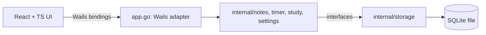

# Architecture

A single local process: Wails hosts a WebView2 window that renders the React UI and exposes Go methods to it.

## Responsibilities

| Component | Responsibility |
| --- | --- |
| Frontend (`frontend/`) | UI, user interaction, view state. Calls Go via `services/` only. |
| `main.go`, `app.go` | Wails startup and a thin adapter exposing bound methods; maps to domain calls. |
| `internal/*` domain packages | Business logic. No Wails imports. Define interfaces for what they need. |
| `internal/storage` | SQLite access, migrations, repository implementations. |
| SQLite | Local persistent data in the per-user app data directory. |

## Rules

- Dependencies flow one way: UI -> `app.go` -> domain -> storage interfaces; `storage` implements domain interfaces.
- The frontend never accesses SQLite.
- Timers compute elapsed time from timestamps; the Go side is the source of truth, and the UI may emit events for display updates.

Detailed rules for agents: [ai/architecture-rules.md](../../ai/architecture-rules.md). Data model: [database design](database-design.md). Directories: [folder structure](folder-structure.md). Decisions: [ADRs](../../ai/decisions/README.md).
